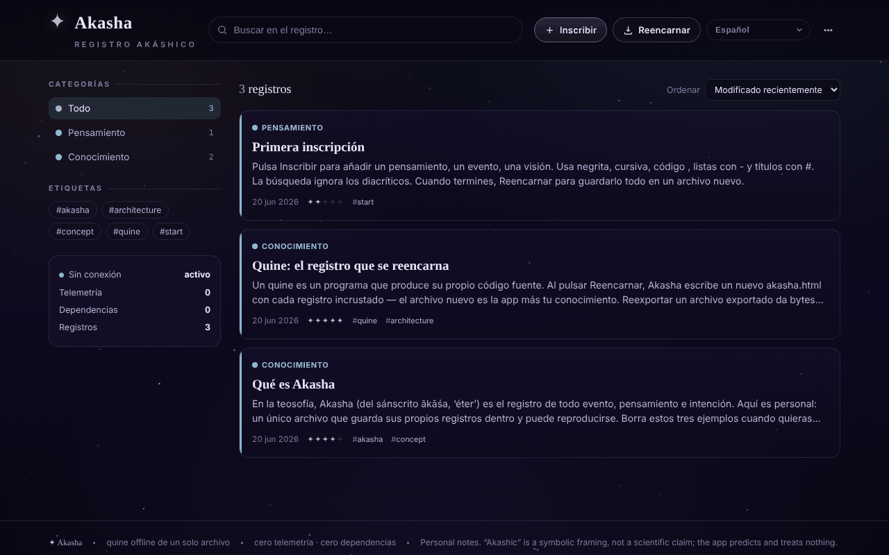

# Akasha

[English](README.md) · [Română](README.ro.md) · [Français](README.fr.md) · [Italiano](README.it.md) · **Español** · [Português](README.pt.md) · [Deutsch](README.de.md) · [Magyar](README.hu.md)

**Versión:** 1.1.8 · **Última actualización:** 2026-10-23

Idiomas de la interfaz: **Română, English, Français, Italiano, Español, Português (PT), Deutsch, Magyar**

Registro akásico sin conexión: un quine HTML en un solo archivo, que se reencarna con todos los registros incorporados.

**En línea:** https://chiuta.github.io/Akasha/

## Qué es

Akasha es un registro personal de anotaciones (pensamientos, eventos, conocimiento, recuerdos, visiones, preguntas) en un solo archivo `index.html`. Es un *quine*: cuando pulsas «Reencarnar», la aplicación escribe una copia nueva de sí misma (`akasha.html`) con todos los registros actuales incorporados al archivo. El archivo nuevo es la aplicación más tus datos.

## Funciones

- Registros con título, categoría (Pensamiento, Evento, Conocimiento, Recuerdo, Visión, Pregunta), «resonancia», etiquetas y contenido con formato sencillo (`**negrita**`, `*cursiva*`, `` `código` ``, listas, títulos).
- Búsqueda, filtrado por categorías y etiquetas, ordenación (Modificados recientemente, Creados recientemente, Resonancia, Alfabético).
- Edición, duplicación y eliminación de registros; menú con «Archivo» y «Estadísticas» (registros, palabras, etiquetas únicas, días cubiertos, desglose por categorías).
- «Ver el propio código»: muestra el código fuente completo que la aplicación escribe al reencarnarse (copiar o descargar).
- «Comprobar la integridad»: verifica la propiedad de punto fijo (reexportación idéntica byte a byte), la presencia única del bloque de datos y la recarga de todos los registros.
- «Exportar JSON», «Exportar Markdown» (un único archivo `akasha-records.md`, con los títulos en orden alfabético) e «Importar (JSON / .html)».
- Enlaces entre registros: `[[Título]]` en el contenido se convierte en un enlace al registro con ese título (sin distinguir mayúsculas de minúsculas; los enlaces sin destino aparecen atenuados), y en el detalle aparece la lista «Mencionado en» (retroenlaces).
- Impresión: el botón «Imprimir» en el detalle de un registro; estilo de impresión en blanco y negro (sin menús ni fondo).
- Fondo estrellado que se puede activar/desactivar (en el tema oscuro); el tema claro sigue la preferencia del sistema.
- Guardado automático de seguridad en el navegador, con un aviso «Restaurar / Ignorar» para cambios más recientes que el archivo; advertencia al cerrar si hay cambios sin guardar.
- Interfaz en 58 idiomas (incluido el rumano), con soporte para escritura de derecha a izquierda (ar, he, fa, ur).

## Novedades (v1.1.0)

- **Lectura en voz alta** (síntesis de voz del navegador, `speechSynthesis`, mediante `FFF.tts`): el botón en el pie del detalle de un registro pronuncia el título y luego el texto; un segundo clic lo detiene; cerrar el panel corta la voz. El idioma de la voz sigue el idioma de la interfaz. Si el navegador no tiene una voz para ese idioma (o no tiene síntesis de voz), aparece un mensaje y no se pronuncia nada. La calidad y la disponibilidad de las voces dependen del sistema.
- **Código QR para un registro**: desde el detalle se genera un QR (prefijo `akasha1:` + JSON con título, categoría, resonancia, etiquetas y texto) de como máximo 1000 bytes. El texto más largo se **trunca, con una advertencia** («X de 6300 caracteres»); no se simula una capacidad que el código no tiene. Desde el menú, «Leer QR desde una imagen» añade un **registro nuevo** (no sobrescribe uno existente); el contenido se valida (categoría, resonancia, longitudes), y un JSON dañado o un QR ajeno se rechazan.
- **Accesibilidad**: panel con «Texto más grande» (zoom 1,2) y «Contraste alto» (también en el tema claro); las preferencias se guardan localmente y no se incorporan a las copias reencarnadas.
- **Kit**: cuadro de diálogo «Transparencia» y copia de seguridad `.fff.json` (módulos `core`, `label`, `bundle`, `qr`, `tts`). Como la aplicación es un quine, el cuadro advierte de que los datos del archivo reencarnado no entran en `localStorage` y, por tanto, no están en la copia `.fff.json`; la fuente de verdad sigue siendo «Reencarnar».
- **Idiomas y traducciones**: los textos nuevos están escritos en rumano e inglés, con variantes en húngaro y alemán; el resto de idiomas usan el inglés para las funciones nuevas. Las traducciones (hu, de) son automáticas y **no han sido verificadas por hablantes nativos**; el kit tiene textos en 8 idiomas, también sin verificar por nativos.

## Manual de uso

1. Abre `index.html` en el navegador.
2. Pulsa «Inscribir» (o la tecla `N`), rellena el título, la categoría, la resonancia, las etiquetas y el contenido, y luego «Guardar».
3. Busca con el campo de búsqueda (tecla `/`) o filtra desde el panel «Categorías» / «Etiquetas»; cambia el orden desde «Ordenar».
4. Abre un registro para editarlo, duplicarlo o eliminarlo.
5. **Para conservar los datos:** pulsa «Reencarnar» (`Ctrl+S` / `Cmd+S`). El navegador descarga `akasha.html`; abre ese archivo la próxima vez, porque contiene todos los registros.
6. Para copias de seguridad: menú «Exportar JSON»; para cargar datos: «Importar (JSON / .html)».
7. Para el idioma, usa el selector de idioma de la interfaz (etiqueta «Idioma»).
8. Otros atajos: `Esc` cierra el cuadro de diálogo o el menú; los atajos de una sola tecla (`N`, `/`) se desactivan mientras escribes en un campo.

## Privacidad y red

- El kit «sin fronteras» (`fff-kit`, módulos `core, label, bundle, qr, tts`) está pegado en `index.html`: no hace solicitudes de red. El cuadro «Transparencia» (clic en la versión) muestra la red declarada (0 solicitudes externas), las claves de `localStorage`, el SHA-256 del archivo y ofrece una copia de seguridad `.fff.json` (opcionalmente cifrada con contraseña, AES-GCM). Los códigos QR se generan y se leen localmente; la lectura se hace solo desde una imagen elegida por el usuario, sin cámara.
- La lectura en voz alta usa el motor de voz del sistema; algunos sistemas pueden enviarlo a un servicio de red del proveedor — la aplicación no controla esto.

- La aplicación no contiene llamadas de red (no tiene `fetch`, CDN ni recursos externos) y no contacta con ningún host de terceros.
- Los datos se conservan en el bloque de datos dentro del archivo HTML (fuente de verdad). Además, `localStorage` contiene una copia de seguridad automática (clave `akasha:autosave:v1`), eliminada tras la reencarnación.
- No hay analítica; la propia aplicación muestra «Telemetría: 0» y «Dependencias: 0».

## Ejecución local / sin conexión

Descarga `index.html` y ábrelo directamente desde el sistema de archivos (`file://`), sin servidor. No requiere internet.

## Licencia

Licencia MIT para el código y la estructura de la aplicación — véase el archivo `LICENSE`. Las eventuales bibliotecas de terceros incluidas en el archivo conservan sus propias licencias.

## Auditoría

Auditoría: 2026-10-10 — verificado con Playwright y axe-core; verificado en el código: sin `fetch`/CDN. Se probó la importación de registros no fiables (JSON con `</script>`, ``): el texto se escapa y el bloque de datos se serializa con `<` → `<`. Corregido: faltaban los márgenes laterales (20 px) en pantalla estrecha. Nota: el nombre «Akasha/registro akásico» es solo temático — la aplicación es una utilidad de notas, sin pretensiones esotéricas.

## Historial / Changelog

### 1.1.6 — 2026-10-22
- fff-kit 1.1.4: objetivos táctiles y tamaño mínimo de texto; objetivos táctiles/texto corregidos

### 1.1.5 — 2026-10-22
- fff-kit 1.1.2: PBKDF2 600 000 iteraciones, protección anti-clickjacking

### 1.1.4 — 2026-10-22

service worker y manifiesto reales (arranca sin conexión cuando se sirve por https; el archivo guardado sigue funcionando desde `file://`); indicador persistente de «cambios sin guardar» con botón «Reencarnar» (antes solo había un aviso al cerrar la pestaña); eliminar un registro pide confirmación en un diálogo integrado en lugar del `confirm()` bloqueante; la etiqueta de versión «Transparencia» tiene un área táctil adecuada. mejoras para móvil y accesibilidad: texto de al menos 12 px y áreas táctiles de al menos 24 px.

### 1.1.3 — 2026-10-22
- El título de la página (document.title) ahora sigue el idioma de la interfaz (Akasha · subtítulo) en lugar de quedarse en rumano.

- 1.1.1 — 2026-10-18: la importación de registros ya no cambia la preferencia «estrellas» (`meta.stars` del archivo se ignora); prueba correspondiente.
- 1.1.0 — 2026-10-14: lectura en voz alta, código QR para un registro (generación + lectura desde una imagen), panel de accesibilidad (texto más grande, contraste alto; corregido el contraste en el tema claro), kit «sin fronteras» (Transparencia + copia `.fff.json`). Pruebas: `tests/fff-r8.test.mjs`.

- 1.0.4 — 2026-10-12: la versión y la fecha de la última actualización se muestran en la aplicación (pie de página, con etiqueta traducida).
- v1.0.3: **tema claro** automático (`prefers-color-scheme: light`; el oscuro sigue siendo el predeterminado; sin interruptor manual, por tanto sin textos nuevos que traducir); el fondo estrellado se oculta en el tema claro. Los colores de las categorías en el texto son ahora variables CSS (`--cat`), oscurecidas en el tema claro para el contraste. Corregido: el cuadro del código fuente («Ver el propio código») no se podía desplazar con el teclado (ahora tiene `tabindex="0"` y un nombre). Hash CSP recalculado; «Comprobar la integridad» tiene éxito en ambos temas; axe-core = 0 infracciones a 1280 y 360 px en ambos temas, incluidos los cuadros de diálogo.
- v1.0.2: la vista previa en la lista ya no elimina los guiones de las palabras (p. ej. «re-export»), solo los marcadores del principio de línea; añadidos «Exportar Markdown», los enlaces `[[Título]]` con «Mencionado en», el botón «Imprimir» y un estilo de impresión (textos nuevos en 7 idiomas; los demás usan el inglés). CSP: hash recalculado.
- Accesibilidad: el título «Akasha» es h1, los paneles laterales son h2, los registros ya no usan `role="button"` en `<article>` (ahora `
`), el lienzo de estrellas se oculta a los lectores de pantalla; axe-core = 0 infracciones a 1280 y 360 px.
- Añadida una política CSP (`<meta>`: scripts solo por hash, `connect-src 'none'`); la comprobación «Integridad del quine» (punto fijo) sigue teniendo éxito.
- La vista previa de un registro que contiene texto del tipo `<script …` se muestra como texto simple (escapado), no interpretado; su truncamiento es solo estético.

## Autor

Alexio — Alexandru-Ionuț Chiuță. Contacto: alexio@trom.tf

## Resumen

Akasha es un «registro akásico» de un único archivo y sin conexión: un quine que, al pulsar «Reencarnar» (Ctrl/Cmd+S), escribe una copia nueva de sí mismo con todos los registros incrustados. Tiene búsqueda, etiquetas, categorías, importación/exportación JSON, una comprobación de integridad y una interfaz en 58 idiomas. No realiza solicitudes de red; una copia de seguridad de autoguardado se conserva en localStorage.
