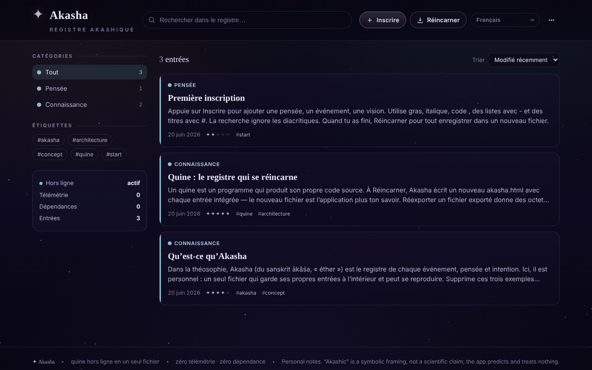

# Akasha

[English](README.md) · [Română](README.ro.md) · **Français** · [Italiano](README.it.md) · [Español](README.es.md) · [Português](README.pt.md) · [Deutsch](README.de.md) · [Magyar](README.hu.md)

**Version :** 1.1.3 · **Dernière mise à jour :** 2026-10-22

Langues de l'interface : **Română, English, Français, Italiano, Español, Português (PT), Deutsch, Magyar**

Registre akashique hors ligne : un quine HTML en un seul fichier, qui se réincarne avec tous les enregistrements intégrés.

**En ligne :** https://chiuta.github.io/Akasha/

## De quoi s'agit-il

Akasha est un registre personnel d'enregistrements (pensées, événements, connaissances, souvenirs, visions, questions) dans un seul fichier `index.html`. C'est un *quine* : lorsque vous appuyez sur « Réincarner », l'application écrit une nouvelle copie d'elle-même (`akasha.html`) avec tous les enregistrements actuels intégrés au fichier. Le nouveau fichier est l'application plus vos données.

## Fonctionnalités

- Enregistrements avec titre, catégorie (Pensée, Événement, Connaissance, Souvenir, Vision, Question), « résonance », étiquettes et contenu avec mise en forme simple (`**gras**`, `*italique*`, `` `code` ``, listes, titres).
- Recherche, filtrage par catégories et étiquettes, tri (Modifié récemment, Créé récemment, Résonance, Alphabétique).
- Modification, duplication et suppression d'enregistrements ; menu avec « Archive » et « Statistiques » (enregistrements, mots, étiquettes uniques, jours couverts, répartition par catégorie).
- « Voir son propre code » : affiche la source complète que l'application écrit lors de la réincarnation (copie ou téléchargement).
- « Vérifier l'intégrité » : vérifie la propriété de point fixe (réexportation à l'octet près), la présence unique du bloc de données et le rechargement de tous les enregistrements.
- « Exporter en JSON », « Exporter en Markdown » (un seul fichier `akasha-records.md`, avec les titres par ordre alphabétique) et « Importer (JSON / .html) ».
- Liens entre enregistrements : `[[Titre]]` dans le contenu devient un lien vers l'enregistrement portant ce titre (sans distinction de casse ; les liens sans cible sont atténués), et le détail affiche la liste « Mentionné dans » (rétroliens).
- Impression : le bouton « Imprimer » dans le détail d'un enregistrement ; style d'impression noir et blanc (sans menus ni fond).
- Fond étoilé pouvant être activé/désactivé (dans le thème sombre) ; le thème clair suit la préférence du système.
- Sauvegarde automatique de sécurité dans le navigateur, avec une bannière « Restaurer / Ignorer » pour les modifications plus récentes que le fichier ; avertissement à la fermeture s'il y a des modifications non enregistrées.
- Interface en 58 langues (dont le roumain), avec prise en charge de l'écriture de droite à gauche (ar, he, fa, ur).

## Nouveautés (v1.1.0)

- **Lecture à voix haute** (synthèse vocale du navigateur, `speechSynthesis`, via `FFF.tts`) : le bouton en pied du détail d'un enregistrement prononce le titre, puis le texte ; un second clic l'arrête ; fermer le panneau coupe la voix. La langue de la voix suit la langue de l'interface. Si le navigateur n'a pas de voix pour cette langue (ou pas de synthèse vocale), un message s'affiche et rien n'est prononcé. La qualité et la disponibilité des voix dépendent du système.
- **Code QR pour un enregistrement** : depuis le détail, un QR est généré (préfixe `akasha1:` + JSON avec le titre, la catégorie, la résonance, les étiquettes et le texte) de 1000 octets au maximum. Un texte plus long est **tronqué, avec un avertissement** (« X sur 6300 caractères ») ; on ne simule pas une capacité que le code n'a pas. Depuis le menu, « Lire un QR depuis une image » ajoute un **nouvel enregistrement** (sans en écraser un autre) ; le contenu est validé (catégorie, résonance, longueurs), et un JSON corrompu ou un QR étranger sont rejetés.
- **Accessibilité** : panneau avec « Texte plus grand » (zoom 1,2) et « Contraste élevé » (y compris dans le thème clair) ; les préférences sont conservées localement et ne sont pas intégrées aux copies réincarnées.
- **Kit** : boîte de dialogue « Transparence » et sauvegarde `.fff.json` (modules `core`, `label`, `bundle`, `qr`, `tts`). L'application étant un quine, la boîte de dialogue avertit que les données du fichier réincarné n'entrent pas dans `localStorage` et ne figurent donc pas dans la sauvegarde `.fff.json` ; la source de vérité reste « Réincarner ».
- **Langues et traductions** : les nouveaux textes sont écrits en roumain et en anglais, avec des variantes hongroise et allemande ; les autres langues utilisent l'anglais pour les nouvelles fonctions. Les traductions (hu, de) sont automatiques et **non vérifiées par des locuteurs natifs** ; le kit a des textes en 8 langues, également non vérifiés par des natifs.

## Mode d'emploi

1. Ouvrez `index.html` dans un navigateur.
2. Appuyez sur « Inscrire » (ou sur la touche `N`), renseignez le titre, la catégorie, la résonance, les étiquettes et le contenu, puis « Enregistrer ».
3. Cherchez avec le champ de recherche (touche `/`) ou filtrez depuis le panneau « Catégories » / « Étiquettes » ; changez l'ordre depuis « Trier ».
4. Ouvrez un enregistrement pour le modifier, le dupliquer ou le supprimer.
5. **Pour conserver vos données :** appuyez sur « Réincarner » (`Ctrl+S` / `Cmd+S`). Le navigateur télécharge `akasha.html` ; ouvrez ce fichier la prochaine fois, car il contient tous les enregistrements.
6. Pour les sauvegardes : menu « Exporter en JSON » ; pour charger des données : « Importer (JSON / .html) ».
7. Pour la langue, utilisez le sélecteur de langue de l'interface (libellé « Langue »).
8. Autres raccourcis : `Échap` ferme la boîte de dialogue ou le menu ; les raccourcis à une seule touche (`N`, `/`) sont désactivés pendant la saisie dans un champ.

## Confidentialité et réseau

- Le kit « sans frontières » (`fff-kit`, modules `core, label, bundle, qr, tts`) est collé dans `index.html` : il ne fait aucune requête réseau. La boîte de dialogue « Transparence » (clic sur la version) montre le réseau déclaré (0 requête externe), les clés de `localStorage`, le SHA-256 du fichier et propose une sauvegarde `.fff.json` (éventuellement chiffrée par mot de passe, AES-GCM). Les codes QR sont générés et lus localement ; la lecture se fait uniquement à partir d'une image choisie par l'utilisateur, sans caméra.
- La lecture à voix haute utilise le moteur vocal du système ; certains systèmes peuvent l'envoyer à un service réseau du fournisseur — l'application ne contrôle pas cela.

- L'application ne contient aucun appel réseau (pas de `fetch`, de CDN ni de ressources externes) et ne contacte aucun hôte tiers.
- Les données sont conservées dans le bloc de données à l'intérieur du fichier HTML (source de vérité). En outre, `localStorage` contient une sauvegarde automatique (clé `akasha:autosave:v1`), supprimée après la réincarnation.
- Il n'y a pas d'analytique ; l'application affiche elle-même « Télémétrie : 0 » et « Dépendances : 0 ».

## Exécution locale / hors ligne

Téléchargez `index.html` et ouvrez-le directement depuis le système de fichiers (`file://`), sans serveur. Aucune connexion Internet n'est nécessaire.

## Licence

Licence MIT pour le code et la structure de l'application — voir le fichier `LICENSE`. Les éventuelles bibliothèques tierces incluses dans le fichier conservent leurs propres licences.

## Audit

Audit : 2026-10-10 — vérifié avec Playwright et axe-core ; vérifié dans le code : pas de `fetch`/CDN. L'importation d'enregistrements non fiables (JSON avec `</script>`, ``) a été testée : le texte est échappé et le bloc de données est sérialisé avec `<` → `<`. Corrigé : les marges latérales (20 px) manquaient sur écran étroit. Remarque : le nom « Akasha/registre akashique » n'est que thématique — l'application est un utilitaire de prise de notes, sans prétention ésotérique.

## Historique / Changelog

### 1.1.3 — 2026-10-22
- Le titre de la page (document.title) suit désormais la langue de l'interface (Akasha · sous-titre) au lieu de rester en roumain.

- 1.1.1 — 2026-10-18 : l'importation de registres ne modifie plus la préférence « étoiles » (`meta.stars` du fichier est ignoré) ; test correspondant.
- 1.1.0 — 2026-10-14 : lecture à voix haute, code QR pour un enregistrement (génération + lecture depuis une image), panneau d'accessibilité (texte plus grand, contraste élevé ; contraste corrigé dans le thème clair), kit « sans frontières » (Transparence + sauvegarde `.fff.json`). Tests : `tests/fff-r8.test.mjs`.

- 1.0.4 — 2026-10-12 : la version et la date de la dernière mise à jour s'affichent dans l'application (pied de page, avec libellé traduit).
- v1.0.3 : **thème clair** automatique (`prefers-color-scheme: light` ; le sombre reste par défaut ; pas de commutateur manuel, donc pas de nouveaux textes à traduire) ; le fond étoilé est masqué dans le thème clair. Les couleurs des catégories dans le texte sont désormais des variables CSS (`--cat`), assombries dans le thème clair pour le contraste. Corrigé : la boîte du code source (« Voir son propre code ») ne pouvait pas défiler au clavier (elle a maintenant `tabindex="0"` et un nom). Hash CSP recalculé ; « Vérifier l'intégrité » réussit dans les deux thèmes ; axe-core = 0 violation à 1280 et 360 px dans les deux thèmes, y compris dans les boîtes de dialogue.
- v1.0.2 : l'aperçu dans la liste ne supprime plus les traits d'union dans les mots (p. ex. « re-export »), seulement les marqueurs en début de ligne ; ajout de « Exporter en Markdown », des liens `[[Titre]]` avec « Mentionné dans », du bouton « Imprimer » et d'un style d'impression (nouveaux textes en 7 langues ; les autres utilisent l'anglais). CSP : hash recalculé.
- Accessibilité : le titre « Akasha » est un h1, les panneaux latéraux sont des h2, les enregistrements n'utilisent plus `role="button"` sur `<article>` (maintenant `
`), le canevas d'étoiles est masqué aux lecteurs d'écran ; axe-core = 0 violation à 1280 et 360 px.
- Ajout d'une politique CSP (`<meta>` : scripts uniquement par hash, `connect-src 'none'`) ; la vérification « Intégrité du quine » (point fixe) reste réussie.
- L'aperçu d'un enregistrement contenant du texte de type `<script …` s'affiche en texte brut (échappé), sans être interprété ; sa troncature n'est que cosmétique.

## Auteur

Alexio — Alexandru-Ionuț Chiuță. Contact : alexio@trom.tf

## Résumé

Akasha est un « registre akashique » hors ligne en un seul fichier : un quine qui, lors de la « Réincarnation » (Ctrl/Cmd+S), écrit une copie neuve de lui-même avec tous les enregistrements intégrés. Il offre la recherche, des étiquettes, des catégories, l'import/export JSON, un contrôle d'intégrité et une interface en 58 langues. Il n'effectue aucune requête réseau ; une sauvegarde automatique est conservée dans localStorage.

