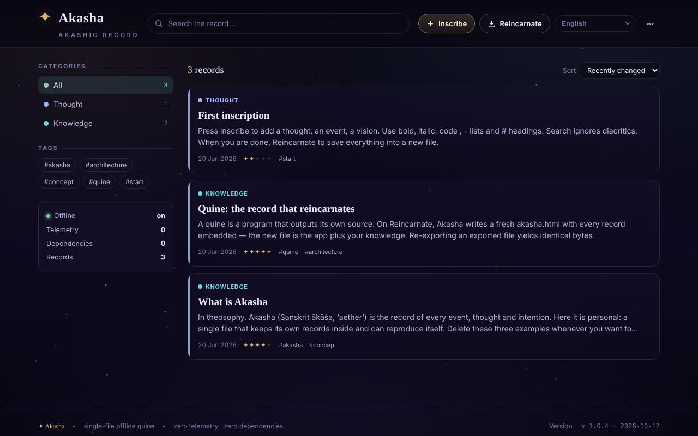

# Akasha

[English](README.md) · [Română](README.ro.md) · [Français](README.fr.md) · [Italiano](README.it.md) · [Español](README.es.md) · [Português](README.pt.md) · [Deutsch](README.de.md) · **Magyar**

**Verzió:** 1.1.1 · **Utolsó frissítés:** 2026-10-18

A felület nyelvei: **Română, English, Français, Italiano, Español, Português (PT), Deutsch, Magyar**

Offline akasha-krónika: egyetlen HTML-fájlból álló quine, amely az összes beágyazott bejegyzéssel újratestesül.

**Élő változat:** https://chiuta.github.io/Akasha/

## Mi ez

Az Akasha személyes bejegyzésnyilvántartás (gondolatok, események, ismeretek, emlékek, látomások, kérdések) egyetlen `index.html` fájlban. *Quine*: amikor megnyomja az „Újratestesülés” gombot, az alkalmazás megírja önmaga új másolatát (`akasha.html`), a fájlba ágyazva az összes aktuális bejegyzést. Az új fájl az alkalmazás plusz az Ön adatai.

## Funkciók

- Bejegyzések címmel, kategóriával (Gondolat, Esemény, Ismeret, Emlék, Látomás, Kérdés), „rezonanciával”, címkékkel és egyszerű formázású tartalommal (`**félkövér**`, `*dőlt*`, `` `kód` ``, listák, címsorok).
- Keresés, szűrés kategóriák és címkék szerint, rendezés (Nemrég módosított, Nemrég létrehozott, Rezonancia, Betűrend).
- Bejegyzések szerkesztése, másolása és törlése; menü „Archívum” és „Statisztika” pontokkal (bejegyzések, szavak, egyedi címkék, lefedett napok, kategóriák szerinti bontás).
- „Saját kód megtekintése”: megjeleníti a teljes forráskódot, amelyet az alkalmazás az újratestesüléskor ír (másolás vagy letöltés).
- „Integritás ellenőrzése”: ellenőrzi a fixpont-tulajdonságot (bájtra azonos újraexportálás), az adatblokk egyedi jelenlétét és az összes bejegyzés újratöltését.
- „JSON exportálása”, „Markdown exportálása” (egyetlen `akasha-records.md` fájl, a címsorok betűrendben) és „Importálás (JSON / .html)”.
- Bejegyzések közötti hivatkozások: a tartalomban a `[[Cím]]` hivatkozássá válik az adott című bejegyzésre (kis- és nagybetűre érzéketlenül; a cél nélküli hivatkozások halványak), a részletnézetben pedig megjelenik az „Említve itt” lista (visszahivatkozások).
- Nyomtatás: a „Nyomtatás” gomb egy bejegyzés részletnézetében; fekete-fehér nyomtatási stílus (menük és háttér nélkül).
- Csillagos háttér, amely be- és kikapcsolható (a sötét témában); a világos téma a rendszerbeállítást követi.
- Automatikus biztonsági mentés a böngészőben, „Visszaállítás / Mellőzés” sávval a fájlnál újabb módosításokhoz; figyelmeztetés bezáráskor, ha vannak nem mentett módosítások.
- Felület 58 nyelven (a románt is beleértve), jobbról balra írás támogatásával (ar, he, fa, ur).

## Újdonságok (v1.1.0)

- **Felolvasás** (a böngésző beszédszintézise, `speechSynthesis`, az `FFF.tts` révén): a bejegyzés részletnézetének láblécében lévő gomb kimondja a címet, majd a szöveget; a második kattintás leállítja; a panel bezárása elnémítja a hangot. A hang nyelve a felület nyelvét követi. Ha a böngészőnek nincs hangja az adott nyelvhez (vagy nincs beszédszintézise), üzenet jelenik meg, és semmi nem hangzik el. A hangok minősége és elérhetősége a rendszertől függ.
- **QR-kód egy bejegyzéshez**: a részletnézetből QR-kód készül (előtag `akasha1:` + JSON a címmel, kategóriával, rezonanciával, címkékkel és szöveggel), legfeljebb 1000 bájt méretben. A hosszabb szöveg **csonkolva, figyelmeztetéssel** kerül bele („X a 6300 karakterből”); nem színlel olyan kapacitást, amellyel a kód nem rendelkezik. A menüben a „QR olvasása képből” **új bejegyzést** ad hozzá (nem ír felül meglévőt); a tartalom érvényesítése megtörténik (kategória, rezonancia, hosszak), a hibás JSON-t vagy az idegen QR-kódot elutasítja.
- **Akadálymentesség**: panel „Nagyobb szöveg” (1,2-szeres nagyítás) és „Magas kontraszt” opcióval (a világos témában is); a beállítások helyben tárolódnak, és nem kerülnek be az újratestesült másolatokba.
- **Kit**: „Átláthatóság” párbeszédablak és `.fff.json` biztonsági mentés (`core`, `label`, `bundle`, `qr`, `tts` modulok). Mivel az alkalmazás quine, a párbeszédablak figyelmeztet, hogy az újratestesült fájl adatai nem kerülnek a `localStorage`-ba, ezért nincsenek benne az `.fff.json` mentésben; a hiteles forrás az „Újratestesülés” marad.
- **Nyelvek és fordítások**: az új szövegek románul és angolul készültek, magyar és német változattal; a többi nyelv az új funkciókhoz az angolt használja. A fordítások (hu, de) automatikusak, és **anyanyelvi beszélők nem ellenőrizték őket**; a kit szövegei 8 nyelvűek, szintén anyanyelvi ellenőrzés nélkül.

## Használati útmutató

1. Nyissa meg az `index.html` fájlt a böngészőben.
2. Nyomja meg a „Beírás” gombot (vagy az `N` billentyűt), töltse ki a címet, kategóriát, rezonanciát, címkéket és a tartalmat, majd „Mentés”.
3. Keressen a keresőmezővel (`/` billentyű), vagy szűrjön a „Kategóriák” / „Címkék” panelen; a sorrendet a „Rendezés” menüben módosíthatja.
4. Nyisson meg egy bejegyzést a szerkesztéshez, másoláshoz vagy törléshez.
5. **Az adatok megőrzéséhez:** nyomja meg az „Újratestesülés” gombot (`Ctrl+S` / `Cmd+S`). A böngésző letölti az `akasha.html` fájlt; legközelebb azt nyissa meg, mert az összes bejegyzést tartalmazza.
6. Biztonsági mentéshez: „JSON exportálása” menü; adatok betöltéséhez: „Importálás (JSON / .html)”.
7. A nyelvhez használja a felület nyelvválasztóját („Nyelv” felirat).
8. Egyéb billentyűparancsok: az `Esc` bezárja a párbeszédablakot vagy a menüt; az egybillentyűs parancsok (`N`, `/`) le vannak tiltva, amíg mezőbe ír.

## Adatvédelem és hálózat

- A „határok nélküli” kit (`fff-kit`, `core, label, bundle, qr, tts` modulok) be van illesztve az `index.html`-be: nem végez hálózati kéréseket. Az „Átláthatóság” párbeszédablak (kattintás a verzióra) megmutatja a deklarált hálózatot (0 külső kérés), a `localStorage` kulcsait, a fájl SHA-256 értékét, és `.fff.json` biztonsági mentést kínál (opcionálisan jelszóval titkosítva, AES-GCM). A QR-kódok előállítása és olvasása helyben történik; az olvasás csak a felhasználó által választott képből történik, kamera nélkül.
- A felolvasás a rendszer beszédmotorját használja; egyes rendszerek ezt a szolgáltató hálózati szolgáltatásához küldhetik — ezt az alkalmazás nem ellenőrzi.

- Az alkalmazás nem tartalmaz hálózati hívásokat (nincs `fetch`, CDN vagy külső erőforrás), és nem veszi fel a kapcsolatot egyetlen harmadik fél gazdagépével sem.
- Az adatok a HTML-fájlon belüli adatblokkban találhatók (hiteles forrás). Ezen felül a `localStorage` automatikus biztonsági mentést tartalmaz (`akasha:autosave:v1` kulcs), amely az újratestesülés után törlődik.
- Nincs analitika; maga az alkalmazás „Telemetria: 0” és „Függőségek: 0” feliratot mutat.

## Helyi / offline futtatás

Töltse le az `index.html` fájlt, és nyissa meg közvetlenül a fájlrendszerből (`file://`), szerver nélkül. Internet nem szükséges.

## Licenc

MIT licenc az alkalmazás kódjára és szerkezetére — lásd a `LICENSE` fájlt. A fájlban esetlegesen szereplő harmadik féltől származó könyvtárak megtartják saját licenceiket.

## Audit

Audit: 2026-10-10 — Playwrighttal és axe-core-ral ellenőrizve; a kódban ellenőrizve: nincs `fetch`/CDN. A nem megbízható bejegyzések importálását (JSON `</script>`, `` tartalommal) tesztelték: a szöveg escape-elt, az adatblokk szerializálása `<` → `<` cserével történik. Javítva: keskeny képernyőn hiányoztak az oldalsó margók (20 px). Megjegyzés: az „Akasha/akasha-krónika” név csak tematikus — az alkalmazás jegyzetelő segédprogram, ezoterikus igények nélkül.

## Előzmények / Changelog

- 1.1.1 — 2026-10-18: a nyilvántartások importálása már nem módosítja a „csillagok” beállítást (a fájl `meta.stars` értékét figyelmen kívül hagyja); megfelelő teszt.
- 1.1.0 — 2026-10-14: felolvasás, QR-kód egy bejegyzéshez (előállítás + olvasás képből), akadálymentesítő panel (nagyobb szöveg, magas kontraszt; javított kontraszt a világos témában), „határok nélküli” kit (Átláthatóság + `.fff.json` mentés). Tesztek: `tests/fff-r8.test.mjs`.

- 1.0.4 — 2026-10-12: a verzió és az utolsó frissítés dátuma megjelenik az alkalmazásban (lábléc, lefordított felirattal).
- v1.0.3: automatikus **világos téma** (`prefers-color-scheme: light`; alapértelmezés szerint a sötét marad; nincs kézi kapcsoló, tehát nincs új lefordítandó szöveg); a csillagos háttér a világos témában el van rejtve. A kategóriák színei a szövegben mostantól CSS-változók (`--cat`), a világos témában a kontraszt érdekében sötétítve. Javítva: a forráskód doboza („Saját kód megtekintése”) billentyűzettel nem volt görgethető (mostantól van `tabindex="0"` és neve). A CSP-hash újraszámolva; az „Integritás ellenőrzése” mindkét témában sikeres; axe-core = 0 szabálysértés 1280 és 360 px-en mindkét témában, a párbeszédablakokban is.
- v1.0.2: a listaelőnézet már nem törli a kötőjeleket a szavakból (pl. „re-export”), csak a sor eleji jelölőket; hozzáadva: „Markdown exportálása”, `[[Cím]]` hivatkozások „Említve itt” listával, a „Nyomtatás” gomb és nyomtatási stílus (új szövegek 7 nyelven; a többi az angolt használja). CSP: hash újraszámolva.
- Akadálymentesség: az „Akasha” cím h1, az oldalsó panelek h2-k, a bejegyzések már nem használnak `role="button"` attribútumot az `<article>` elemen (most `
`), a csillagvászon el van rejtve a képernyőolvasók elől; axe-core = 0 szabálysértés 1280 és 360 px-en.
- CSP-szabályzat hozzáadva (`<meta>`: szkriptek csak hash alapján, `connect-src 'none'`); a „Quine-integritás” (fixpont) ellenőrzés továbbra is sikeres.
- Az olyan bejegyzés előnézete, amely `<script …` jellegű szöveget tartalmaz, egyszerű szövegként (escape-elve) jelenik meg, nem értelmeződik; a csonkolása csak esztétikai.

## Szerző

Alexio — Alexandru-Ionuț Chiuță. Kapcsolat: alexio@trom.tf

## English summary

Akasha is a single-file offline "akashic record": a quine that, on "Reincarnate" (Ctrl/Cmd+S), writes a fresh copy of itself with all records embedded. It has search, tags, categories, JSON import/export, an integrity check, and a UI in 58 languages. It makes no network requests; an autosave backup is kept in localStorage.
