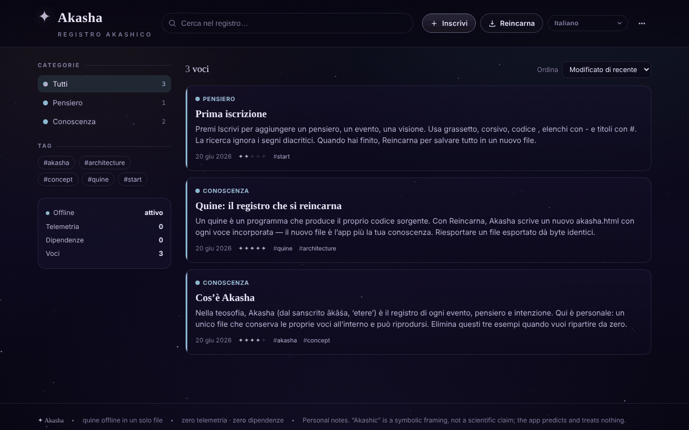

# Akasha

[English](README.md) · [Română](README.ro.md) · [Français](README.fr.md) · **Italiano** · [Español](README.es.md) · [Português](README.pt.md) · [Deutsch](README.de.md) · [Magyar](README.hu.md)

**Versione:** 1.1.4 · **Ultimo aggiornamento:** 2026-10-22

Lingue dell'interfaccia: **Română, English, Français, Italiano, Español, Português (PT), Deutsch, Magyar**

Registro akashico offline: un quine HTML in un unico file, che si reincarna con tutte le registrazioni incorporate.

**Online:** https://chiuta.github.io/Akasha/

## Cos'è

Akasha è un registro personale di annotazioni (pensieri, eventi, conoscenze, ricordi, visioni, domande) in un unico file `index.html`. È un *quine*: quando premi «Reincarna», l'applicazione scrive una nuova copia di sé stessa (`akasha.html`) con tutte le registrazioni correnti incorporate nel file. Il nuovo file è l'applicazione più i tuoi dati.

## Funzioni

- Registrazioni con titolo, categoria (Pensiero, Evento, Conoscenza, Ricordo, Visione, Domanda), «risonanza», etichette e contenuto con formattazione semplice (`**grassetto**`, `*corsivo*`, `` `codice` ``, elenchi, titoli).
- Ricerca, filtro per categorie ed etichette, ordinamento (Modificate di recente, Create di recente, Risonanza, Alfabetico).
- Modifica, duplicazione ed eliminazione delle registrazioni; menu con «Archivio» e «Statistiche» (registrazioni, parole, etichette uniche, giorni coperti, ripartizione per categoria).
- «Vedi il proprio codice»: mostra il sorgente completo che l'applicazione scrive durante la reincarnazione (copia o download).
- «Verifica l'integrità»: verifica la proprietà di punto fisso (riesportazione identica byte per byte), la presenza unica del blocco di dati e il ricaricamento di tutte le registrazioni.
- «Esporta JSON», «Esporta Markdown» (un unico file `akasha-records.md`, con i titoli in ordine alfabetico) e «Importa (JSON / .html)».
- Collegamenti tra registrazioni: `[[Titolo]]` nel contenuto diventa un collegamento alla registrazione con quel titolo (senza distinzione tra maiuscole e minuscole; i collegamenti senza destinazione sono attenuati), e nel dettaglio compare l'elenco «Citato in» (collegamenti inversi).
- Stampa: il pulsante «Stampa» nel dettaglio di una registrazione; stile di stampa in bianco e nero (senza menu né sfondo).
- Sfondo stellato attivabile/disattivabile (nel tema scuro); il tema chiaro segue la preferenza del sistema.
- Salvataggio automatico di sicurezza nel browser, con un banner «Ripristina / Ignora» per le modifiche più recenti del file; avviso alla chiusura se ci sono modifiche non salvate.
- Interfaccia in 58 lingue (incluso il rumeno), con supporto per la scrittura da destra a sinistra (ar, he, fa, ur).

## Novità (v1.1.0)

- **Lettura ad alta voce** (sintesi vocale del browser, `speechSynthesis`, tramite `FFF.tts`): il pulsante nel piè di pagina del dettaglio di una registrazione pronuncia il titolo, poi il testo; un secondo clic lo ferma; chiudere il pannello ferma la voce. La lingua della voce segue la lingua dell'interfaccia. Se il browser non ha una voce per quella lingua (o non ha la sintesi vocale), compare un messaggio e non viene pronunciato nulla. La qualità e la disponibilità delle voci dipendono dal sistema.
- **Codice QR per una registrazione**: dal dettaglio si genera un QR (prefisso `akasha1:` + JSON con titolo, categoria, risonanza, etichette e testo) di al massimo 1000 byte. Il testo più lungo viene **troncato, con un avviso** («X di 6300 caratteri»); non si simula una capacità che il codice non ha. Dal menu, «Leggi QR da un'immagine» aggiunge una **nuova registrazione** (non ne sovrascrive una); il contenuto è validato (categoria, risonanza, lunghezze), e un JSON corrotto o un QR estraneo vengono rifiutati.
- **Accessibilità**: pannello con «Testo più grande» (zoom 1,2) e «Contrasto elevato» (anche nel tema chiaro); le preferenze sono conservate localmente e non sono incorporate nelle copie reincarnate.
- **Kit**: finestra «Trasparenza» e copia di sicurezza `.fff.json` (moduli `core`, `label`, `bundle`, `qr`, `tts`). Poiché l'applicazione è un quine, la finestra avverte che i dati del file reincarnato non entrano in `localStorage` e quindi non sono nella copia `.fff.json`; la fonte di verità resta «Reincarna».
- **Lingue e traduzioni**: i nuovi testi sono scritti in rumeno e inglese, con varianti ungherese e tedesca; le altre lingue usano l'inglese per le nuove funzioni. Le traduzioni (hu, de) sono automatiche e **non verificate da madrelingua**; il kit ha testi in 8 lingue, anch'essi non verificati da madrelingua.

## Guida all'uso

1. Apri `index.html` nel browser.
2. Premi «Inscrivi» (o il tasto `N`), compila titolo, categoria, risonanza, etichette e contenuto, poi «Salva».
3. Cerca con il campo di ricerca (tasto `/`) o filtra dal pannello «Categorie» / «Etichette»; cambia l'ordine da «Ordina».
4. Apri una registrazione per modificarla, duplicarla o eliminarla.
5. **Per conservare i dati:** premi «Reincarna» (`Ctrl+S` / `Cmd+S`). Il browser scarica `akasha.html`; apri quel file la volta successiva, perché contiene tutte le registrazioni.
6. Per le copie di sicurezza: menu «Esporta JSON»; per caricare dati: «Importa (JSON / .html)».
7. Per la lingua, usa il selettore di lingua dell'interfaccia (etichetta «Lingua»).
8. Altre scorciatoie: `Esc` chiude la finestra o il menu; le scorciatoie a un solo tasto (`N`, `/`) sono disattivate mentre scrivi in un campo.

## Privacy e rete

- Il kit «senza frontiere» (`fff-kit`, moduli `core, label, bundle, qr, tts`) è incollato in `index.html`: non effettua richieste di rete. La finestra «Trasparenza» (clic sulla versione) mostra la rete dichiarata (0 richieste esterne), le chiavi di `localStorage`, lo SHA-256 del file e offre una copia di sicurezza `.fff.json` (opzionalmente cifrata con password, AES-GCM). I codici QR sono generati e letti localmente; la lettura avviene solo da un'immagine scelta dall'utente, senza fotocamera.
- La lettura ad alta voce usa il motore vocale del sistema; alcuni sistemi possono inviarlo a un servizio di rete del fornitore — l'applicazione non controlla questo aspetto.

- L'applicazione non contiene chiamate di rete (non ha `fetch`, CDN né risorse esterne) e non contatta alcun host di terze parti.
- I dati sono conservati nel blocco di dati all'interno del file HTML (fonte di verità). Inoltre, `localStorage` contiene una copia di sicurezza automatica (chiave `akasha:autosave:v1`), eliminata dopo la reincarnazione.
- Non ci sono strumenti di analisi; l'applicazione stessa mostra «Telemetria: 0» e «Dipendenze: 0».

## Esecuzione locale / offline

Scarica `index.html` e aprilo direttamente dal file system (`file://`), senza server. Non richiede Internet.

## Licenza

Licenza MIT per il codice e la struttura dell'applicazione — vedi il file `LICENSE`. Le eventuali librerie di terze parti incluse nel file mantengono le proprie licenze.

## Audit

Audit: 2026-10-10 — verificato con Playwright e axe-core; verificato nel codice: nessun `fetch`/CDN. L'importazione di registrazioni non attendibili (JSON con `</script>`, ``) è stata testata: il testo è sottoposto a escape e il blocco di dati è serializzato con `<` → `<`. Corretto: mancavano i margini laterali (20 px) su schermo stretto. Nota: il nome «Akasha/registro akashico» è solo tematico — l'applicazione è un'utilità per appunti, senza pretese esoteriche.

## Storico / Changelog

### 1.1.4 — 2026-10-22

service worker e manifest reali (parte offline quando è servita via https; il file salvato continua a funzionare da `file://`); indicatore persistente «modifiche non salvate» con pulsante «Reincarna» (prima c’era solo l’avviso alla chiusura della scheda); l’eliminazione di una registrazione chiede conferma in una finestra in linea invece del `confirm()` bloccante; l’etichetta di versione «Trasparenza» ha un’area tattile adeguata. rifiniture per mobile e accessibilità: testo di almeno 12 px e aree tattili di almeno 24 px.

### 1.1.3 — 2026-10-22
- Il titolo della pagina (document.title) segue ora la lingua dell'interfaccia (Akasha · sottotitolo) invece di restare in rumeno.

- 1.1.1 — 2026-10-18: l'importazione di registri non cambia più la preferenza «stelle» (`meta.stars` dal file viene ignorato); test corrispondente.
- 1.1.0 — 2026-10-14: lettura ad alta voce, codice QR per una registrazione (generazione + lettura da un'immagine), pannello di accessibilità (testo più grande, contrasto elevato; corretto il contrasto nel tema chiaro), kit «senza frontiere» (Trasparenza + copia `.fff.json`). Test: `tests/fff-r8.test.mjs`.

- 1.0.4 — 2026-10-12: la versione e la data dell'ultimo aggiornamento sono mostrate nell'applicazione (piè di pagina, con etichetta tradotta).
- v1.0.3: **tema chiaro** automatico (`prefers-color-scheme: light`; quello scuro resta predefinito; nessun interruttore manuale, quindi nessun nuovo testo da tradurre); lo sfondo stellato è nascosto nel tema chiaro. I colori delle categorie nel testo sono ora variabili CSS (`--cat`), scurite nel tema chiaro per il contrasto. Corretto: il riquadro del codice sorgente («Vedi il proprio codice») non poteva essere scorso da tastiera (ora ha `tabindex="0"` e un nome). Hash CSP ricalcolato; «Verifica l'integrità» riesce in entrambi i temi; axe-core = 0 violazioni a 1280 e 360 px in entrambi i temi, comprese le finestre di dialogo.
- v1.0.2: l'anteprima nell'elenco non elimina più i trattini dalle parole (es. «re-export»), ma solo i marcatori a inizio riga; aggiunti «Esporta Markdown», i collegamenti `[[Titolo]]` con «Citato in», il pulsante «Stampa» e uno stile di stampa (nuovi testi in 7 lingue; le altre usano l'inglese). CSP: hash ricalcolato.
- Accessibilità: il titolo «Akasha» è h1, i pannelli laterali sono h2, le registrazioni non usano più `role="button"` su `<article>` (ora `
`), il canvas delle stelle è nascosto agli screen reader; axe-core = 0 violazioni a 1280 e 360 px.
- Aggiunta una politica CSP (`<meta>`: script solo tramite hash, `connect-src 'none'`); la verifica «Integrità del quine» (punto fisso) continua a riuscire.
- L'anteprima di una registrazione che contiene testo del tipo `<script …` è mostrata come testo semplice (con escape), non interpretata; il suo troncamento è solo estetico.

## Autore

Alexio — Alexandru-Ionuț Chiuță. Contatto: alexio@trom.tf

## Riepilogo

Akasha è un «registro akashico» offline in un unico file: un quine che, con «Reincarnate» (Ctrl/Cmd+S), scrive una copia nuova di sé con tutti i record incorporati. Offre ricerca, tag, categorie, importazione/esportazione JSON, un controllo di integrità e un'interfaccia in 58 lingue. Non effettua richieste di rete; un backup di salvataggio automatico è conservato in localStorage.
