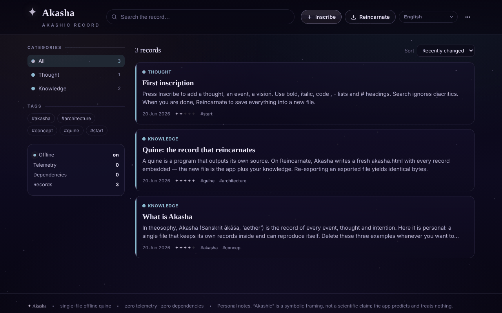

# Akasha

**English** · [Română](README.ro.md) · [Français](README.fr.md) · [Italiano](README.it.md) · [Español](README.es.md) · [Português](README.pt.md) · [Deutsch](README.de.md) · [Magyar](README.hu.md)

**Version:** 1.1.4 · **Last updated:** 2026-10-22

Interface languages: **Română, English, Français, Italiano, Español, Português (PT), Deutsch, Magyar**

Offline akashic record: a single-file HTML quine that reincarnates itself with all the records embedded.

**Live:** https://chiuta.github.io/Akasha/

## What it is

Akasha is a personal register of records (thoughts, events, knowledge, memories, visions, questions) in a single `index.html` file. It is a *quine*: when you press "Reincarnate", the application writes a new copy of itself (`akasha.html`) with all the current records embedded in the file. The new file is the application plus your data.

## Features

- Records with a title, category (Thought, Event, Knowledge, Memory, Vision, Question), "resonance", tags and content with simple formatting (`**bold**`, `*italic*`, `` `code` ``, lists, headings).
- Search, filtering by categories and tags, sorting (Recently modified, Recently created, Resonance, Alphabetical).
- Editing, duplicating and deleting records; a menu with "Archive" and "Statistics" (records, words, unique tags, days covered, breakdown by category).
- "View own code": shows the complete source that the application writes on reincarnation (copy or download).
- "Check integrity": verifies the fix-point property (re-export with byte-identical output), the unique presence of the data block and the reloading of all records.
- "Export JSON", "Export Markdown" (a single `akasha-records.md` file, with headings in alphabetical order) and "Import (JSON / .html)".
- Links between records: `[[Title]]` in the content becomes a link to the record with that title (case-insensitive; links without a target are dimmed), and the detail view shows a "Mentioned in" list (backlinks).
- Printing: the "Print" button in a record's detail view; black-and-white print style (no menus or background).
- Starry background that can be switched on/off (in the dark theme); the light theme follows the system preference.
- Automatic backup saved in the browser, with a "Restore / Ignore" banner for changes newer than the file; warning on closing if there are unsaved changes.
- Interface in 58 languages (including Romanian), with support for right-to-left writing (ar, he, fa, ur).

## New features (v1.1.0)

- **Read aloud** (the browser's speech synthesis, `speechSynthesis`, via `FFF.tts`): the button in the footer of a record's detail view speaks the title, then the text; a second click stops it; closing the panel stops the voice. The voice language follows the interface language. If the browser has no voice for that language (or no speech synthesis), a message appears and nothing is spoken. The quality and availability of voices depend on the system.
- **QR code for a record**: from the detail view a QR is generated (prefix `akasha1:` + JSON with the title, category, resonance, tags and text) of at most 1000 bytes. Longer text is **truncated, with a warning** ("X of 6300 characters"); no capacity that the code does not have is simulated. From the menu, "Read QR from an image" adds a **new record** (it does not overwrite one); the content is validated (category, resonance, lengths), and broken JSON or a foreign QR is rejected.
- **Accessibility**: a panel with "Larger text" (zoom 1.2) and "High contrast" (including in the light theme); the preferences are kept locally and are not embedded in reincarnated copies.
- **Kit**: "Transparency" dialog and `.fff.json` backup (modules `core`, `label`, `bundle`, `qr`, `tts`). Because the application is a quine, the dialog warns that the data in the reincarnated file does not go into `localStorage` and is therefore not in the `.fff.json` backup; the source of truth remains "Reincarnate".
- **Languages and translations**: The new texts are written in Romanian and English, with Hungarian and German variants; the other languages use English for the new features. The translations (hu, de) are automatic and **not verified by native speakers**; the kit has texts in 8 languages, also not natively verified.

## User guide

1. Open `index.html` in a browser.
2. Press "Inscribe" (or the `N` key), fill in the title, category, resonance, tags and content, then "Save".
3. Search with the search field (the `/` key) or filter from the "Categories" / "Tags" panel; change the order from "Sort".
4. Open a record to edit, duplicate or delete it.
5. **To keep your data:** press "Reincarnate" (`Ctrl+S` / `Cmd+S`). The browser downloads `akasha.html`; open that file next time, because it contains all the records.
6. For backups: the "Export JSON" menu; to load data: "Import (JSON / .html)".
7. For the language, use the language selector in the interface (the "Language" label).
8. Other shortcuts: `Esc` closes the dialog or menu; single-key shortcuts (`N`, `/`) are disabled while you are typing in a field.

## Privacy and network

- The "without borders" kit (`fff-kit`, modules `core, label, bundle, qr, tts`) is pasted into `index.html`: it makes no network requests. The "Transparency" dialog (click on the version) shows the declared network (0 external requests), the `localStorage` keys, the SHA-256 of the file and offers a `.fff.json` backup (optionally password-encrypted, AES-GCM). QR codes are generated and read locally; reading is done only from an image chosen by the user, without a camera.
- Reading aloud uses the system's speech engine; some systems may send it to a network service of the vendor — the application does not control this.

- The application contains no network calls (it has no `fetch`, CDNs or external resources) and contacts no third-party host.
- The data is kept in the data block inside the HTML file (the source of truth). In addition, `localStorage` holds an automatic backup (key `akasha:autosave:v1`), deleted after reincarnation.
- There are no analytics; the application itself displays "Telemetry: 0" and "Dependencies: 0".

## Local / offline use

Download `index.html` and open it directly from the file system (`file://`), without a server. No internet required.

## License

MIT license for the code and structure of the application — see the `LICENSE` file. Any third-party libraries included in the file keep their own licenses.

## Audit

Audit: 2026-10-10 — verified with Playwright and axe-core; verified in the code: no `fetch`/CDN. The import of untrusted records (JSON with `</script>`, ``) was tested: the text is escaped, and the data block is serialized with `<` → `<`. Fixed: the side margins (20 px) were missing on a narrow screen. Note: the name "Akasha/akashic record" is only thematic — the application is a note-taking utility, with no esoteric claims.

## History / Changelog

### 1.1.4 — 2026-10-22

real service worker and manifest (starts offline when served over https; the saved file still works from `file://`); a persistent “unsaved changes” indicator with a “Reincarnate” button (previously only a warning when closing the tab); deleting a record asks for confirmation in an inline dialog instead of the blocking `confirm()`; the “Transparency” version label is a proper touch target. mobile and accessibility polish: text at least 12 px and touch targets at least 24 px.

### 1.1.3 — 2026-10-22
- The page title (document.title) now follows the interface language (Akasha · tagline) instead of staying Romanian.

- 1.1.1 — 2026-10-18: importing registers no longer changes the "stars" preference (`meta.stars` from the file is ignored); corresponding test.
- 1.1.0 — 2026-10-14: read aloud, QR code for a record (generation + reading from an image), accessibility panel (larger text, high contrast; light-theme contrast fixed), "without borders" kit (Transparency + `.fff.json` backup). Tests: `tests/fff-r8.test.mjs`.

- 1.0.4 — 2026-10-12: the version and the date of the last update are shown in the application (footer, with translated label).
- v1.0.3: automatic **light theme** (`prefers-color-scheme: light`; dark remains the default; no manual switch, hence no new texts to translate); the starry background is hidden in the light theme. The category colors in the text are now CSS variables (`--cat`), darkened in the light theme for contrast. Fixed: the source-code box ("View own code") could not be scrolled from the keyboard (it now has `tabindex="0"` and a name). CSP hash recomputed; "Check integrity" succeeds in both themes; axe-core = 0 violations at 1280 and 360 px in both themes, including in dialogs.
- v1.0.2: the preview in the list no longer strips hyphens from words (e.g. "re-export"), only the markers at the start of the line; added "Export Markdown", `[[Title]]` links with "Mentioned in", the "Print" button and a print style (new texts in 7 languages; the others use English). CSP: hash recomputed.
- Accessibility: the "Akasha" title is h1, the side panels are h2, records no longer use `role="button"` on `<article>` (now `
`), the star canvas is hidden from screen readers; axe-core = 0 violations at 1280 and 360 px.
- Added a CSP policy (`<meta>`: scripts only by hash, `connect-src 'none'`); the "Quine integrity" (fix-point) check remains successful.
- The preview of a record containing `<script …` text is displayed as plain text (escaped), not interpreted; its truncation is only cosmetic.

## Author

Alexio — Alexandru-Ionuț Chiuță. Contact: alexio@trom.tf

## English summary

Akasha is a single-file offline "akashic record": a quine that, on "Reincarnate" (Ctrl/Cmd+S), writes a fresh copy of itself with all records embedded. It has search, tags, categories, JSON import/export, an integrity check, and a UI in 58 languages. It makes no network requests; an autosave backup is kept in localStorage.
