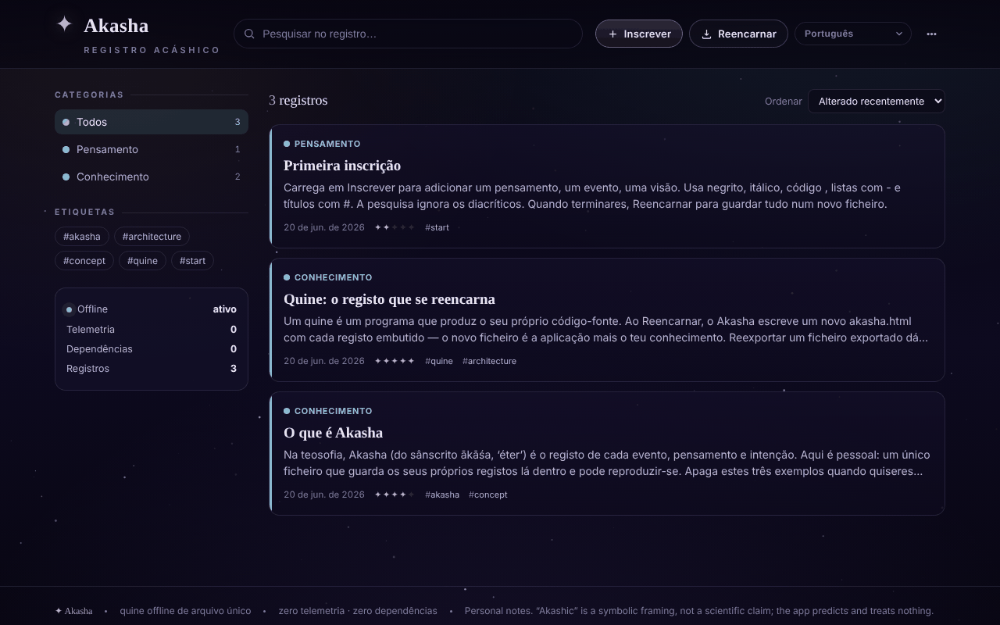

# Akasha

[English](README.md) · [Română](README.ro.md) · [Français](README.fr.md) · [Italiano](README.it.md) · [Español](README.es.md) · **Português** · [Deutsch](README.de.md) · [Magyar](README.hu.md)

**Versão:** 1.1.5 · **Última atualização:** 2026-10-22

Idiomas da interface: **Română, English, Français, Italiano, Español, Português (PT), Deutsch, Magyar**

Registo akáshico offline: um quine HTML num único ficheiro, que se reencarna com todos os registos incorporados.

**Online:** https://chiuta.github.io/Akasha/

## O que é

O Akasha é um registo pessoal de entradas (pensamentos, eventos, conhecimento, memórias, visões, perguntas) num único ficheiro `index.html`. É um *quine*: quando carrega em «Reencarnar», a aplicação escreve uma nova cópia de si própria (`akasha.html`) com todas as entradas atuais incorporadas no ficheiro. O novo ficheiro é a aplicação mais os seus dados.

## Funcionalidades

- Entradas com título, categoria (Pensamento, Evento, Conhecimento, Memória, Visão, Pergunta), «ressonância», etiquetas e conteúdo com formatação simples (`**negrito**`, `*itálico*`, `` `código` ``, listas, títulos).
- Pesquisa, filtragem por categorias e etiquetas, ordenação (Modificadas recentemente, Criadas recentemente, Ressonância, Alfabética).
- Edição, duplicação e eliminação de entradas; menu com «Arquivo» e «Estatísticas» (entradas, palavras, etiquetas únicas, dias abrangidos, discriminação por categoria).
- «Ver o próprio código»: mostra o código-fonte completo que a aplicação escreve na reencarnação (copiar ou transferir).
- «Verificar a integridade»: verifica a propriedade de ponto fixo (reexportação idêntica byte a byte), a presença única do bloco de dados e o recarregamento de todas as entradas.
- «Exportar JSON», «Exportar Markdown» (um único ficheiro `akasha-records.md`, com os títulos por ordem alfabética) e «Importar (JSON / .html)».
- Ligações entre entradas: `[[Título]]` no conteúdo torna-se uma ligação para a entrada com esse título (sem distinção entre maiúsculas e minúsculas; as ligações sem destino aparecem atenuadas), e no detalhe surge a lista «Mencionado em» (ligações inversas).
- Impressão: o botão «Imprimir» no detalhe de uma entrada; estilo de impressão a preto e branco (sem menus nem fundo).
- Fundo estrelado que pode ser ligado/desligado (no tema escuro); o tema claro segue a preferência do sistema.
- Gravação automática de segurança no navegador, com um aviso «Restaurar / Ignorar» para alterações mais recentes do que o ficheiro; aviso ao fechar se houver alterações não guardadas.
- Interface em 58 idiomas (incluindo o romeno), com suporte para escrita da direita para a esquerda (ar, he, fa, ur).

## Novidades (v1.1.0)

- **Leitura em voz alta** (síntese de voz do navegador, `speechSynthesis`, através de `FFF.tts`): o botão no rodapé do detalhe de uma entrada pronuncia o título e depois o texto; um segundo clique para; fechar o painel corta a voz. O idioma da voz segue o idioma da interface. Se o navegador não tiver uma voz para esse idioma (ou não tiver síntese de voz), surge uma mensagem e nada é pronunciado. A qualidade e a disponibilidade das vozes dependem do sistema.
- **Código QR para uma entrada**: a partir do detalhe gera-se um QR (prefixo `akasha1:` + JSON com título, categoria, ressonância, etiquetas e texto) de, no máximo, 1000 bytes. O texto mais longo é **truncado, com aviso** («X de 6300 carateres»); não se simula uma capacidade que o código não tem. No menu, «Ler QR a partir de uma imagem» adiciona uma **entrada nova** (não substitui nenhuma); o conteúdo é validado (categoria, ressonância, comprimentos), e um JSON danificado ou um QR estranho são rejeitados.
- **Acessibilidade**: painel com «Texto maior» (zoom 1,2) e «Contraste elevado» (também no tema claro); as preferências ficam guardadas localmente e não são incorporadas nas cópias reencarnadas.
- **Kit**: caixa de diálogo «Transparência» e cópia de segurança `.fff.json` (módulos `core`, `label`, `bundle`, `qr`, `tts`). Como a aplicação é um quine, a caixa avisa que os dados do ficheiro reencarnado não entram em `localStorage` e, portanto, não constam da cópia `.fff.json`; a fonte de verdade continua a ser «Reencarnar».
- **Idiomas e traduções**: os textos novos estão escritos em romeno e inglês, com variantes em húngaro e alemão; os restantes idiomas usam o inglês para as funcionalidades novas. As traduções (hu, de) são automáticas e **não foram verificadas por falantes nativos**; o kit tem textos em 8 idiomas, também sem verificação nativa.

## Manual de utilização

1. Abra `index.html` no navegador.
2. Carregue em «Inscrever» (ou na tecla `N`), preencha o título, a categoria, a ressonância, as etiquetas e o conteúdo, e depois «Guardar».
3. Pesquise com o campo de pesquisa (tecla `/`) ou filtre a partir do painel «Categorias» / «Etiquetas»; mude a ordem em «Ordenar».
4. Abra uma entrada para a editar, duplicar ou eliminar.
5. **Para conservar os dados:** carregue em «Reencarnar» (`Ctrl+S` / `Cmd+S`). O navegador transfere `akasha.html`; abra esse ficheiro da próxima vez, porque contém todas as entradas.
6. Para cópias de segurança: menu «Exportar JSON»; para carregar dados: «Importar (JSON / .html)».
7. Para o idioma, use o seletor de idioma da interface (etiqueta «Idioma»).
8. Outros atalhos: `Esc` fecha a caixa de diálogo ou o menu; os atalhos de uma só tecla (`N`, `/`) ficam desativados enquanto escreve num campo.

## Privacidade e rede

- O kit «sem fronteiras» (`fff-kit`, módulos `core, label, bundle, qr, tts`) está colado em `index.html`: não faz pedidos de rede. A caixa «Transparência» (clique na versão) mostra a rede declarada (0 pedidos externos), as chaves de `localStorage`, o SHA-256 do ficheiro e oferece uma cópia de segurança `.fff.json` (opcionalmente cifrada com palavra-passe, AES-GCM). Os códigos QR são gerados e lidos localmente; a leitura faz-se apenas a partir de uma imagem escolhida pelo utilizador, sem câmara.
- A leitura em voz alta usa o motor de voz do sistema; alguns sistemas podem enviá-lo para um serviço de rede do fornecedor — a aplicação não controla isso.

- A aplicação não contém chamadas de rede (não tem `fetch`, CDN nem recursos externos) e não contacta nenhum anfitrião de terceiros.
- Os dados ficam no bloco de dados dentro do ficheiro HTML (fonte de verdade). Além disso, `localStorage` contém uma cópia de segurança automática (chave `akasha:autosave:v1`), eliminada após a reencarnação.
- Não há análise de utilização; a própria aplicação mostra «Telemetria: 0» e «Dependências: 0».

## Execução local / offline

Transfira `index.html` e abra-o diretamente a partir do sistema de ficheiros (`file://`), sem servidor. Não necessita de internet.

## Licença

Licença MIT para o código e a estrutura da aplicação — veja o ficheiro `LICENSE`. As eventuais bibliotecas de terceiros incluídas no ficheiro mantêm as suas próprias licenças.

## Auditoria

Auditoria: 2026-10-10 — verificado com Playwright e axe-core; verificado no código: sem `fetch`/CDN. A importação de entradas não fiáveis (JSON com `</script>`, ``) foi testada: o texto é escapado e o bloco de dados é serializado com `<` → `<`. Corrigido: faltavam as margens laterais (20 px) em ecrã estreito. Nota: o nome «Akasha/registo akáshico» é apenas temático — a aplicação é um utilitário de notas, sem pretensões esotéricas.

## Histórico / Changelog

### 1.1.5 — 2026-10-22
- fff-kit 1.1.2: PBKDF2 600 000 iterações, proteção anti-clickjacking

### 1.1.4 — 2026-10-22

service worker e manifesto reais (arranca offline quando servida por https; o ficheiro guardado continua a funcionar a partir de `file://`); indicador persistente de «alterações por guardar» com botão «Reencarnar» (antes havia apenas um aviso ao fechar o separador); eliminar um registo pede confirmação numa caixa de diálogo integrada em vez do `confirm()` bloqueante; a etiqueta de versão «Transparência» tem uma área tátil adequada. melhorias para telemóvel e acessibilidade: texto de pelo menos 12 px e áreas táteis de pelo menos 24 px.

### 1.1.3 — 2026-10-22
- O título da página (document.title) acompanha agora o idioma da interface (Akasha · subtítulo), em vez de ficar em romeno.

- 1.1.1 — 2026-10-18: a importação de registos já não altera a preferência «estrelas» (`meta.stars` do ficheiro é ignorado); teste correspondente.
- 1.1.0 — 2026-10-14: leitura em voz alta, código QR para uma entrada (geração + leitura a partir de uma imagem), painel de acessibilidade (texto maior, contraste elevado; corrigido o contraste no tema claro), kit «sem fronteiras» (Transparência + cópia `.fff.json`). Testes: `tests/fff-r8.test.mjs`.

- 1.0.4 — 2026-10-12: a versão e a data da última atualização são mostradas na aplicação (rodapé, com etiqueta traduzida).
- v1.0.3: **tema claro** automático (`prefers-color-scheme: light`; o escuro continua por omissão; sem interruptor manual, portanto sem textos novos para traduzir); o fundo estrelado fica oculto no tema claro. As cores das categorias no texto são agora variáveis CSS (`--cat`), escurecidas no tema claro para o contraste. Corrigido: a caixa do código-fonte («Ver o próprio código») não podia ser deslocada com o teclado (agora tem `tabindex="0"` e um nome). Hash CSP recalculado; «Verificar a integridade» é bem-sucedida nos dois temas; axe-core = 0 violações a 1280 e 360 px nos dois temas, incluindo nas caixas de diálogo.
- v1.0.2: a pré-visualização na lista já não retira os hífenes das palavras (p. ex. «re-export»), apenas os marcadores no início da linha; adicionados «Exportar Markdown», as ligações `[[Título]]` com «Mencionado em», o botão «Imprimir» e um estilo de impressão (textos novos em 7 idiomas; os outros usam o inglês). CSP: hash recalculado.
- Acessibilidade: o título «Akasha» é h1, os painéis laterais são h2, as entradas já não usam `role="button"` em `<article>` (agora `
`), a tela das estrelas fica oculta para os leitores de ecrã; axe-core = 0 violações a 1280 e 360 px.
- Adicionada uma política CSP (`<meta>`: scripts apenas por hash, `connect-src 'none'`); a verificação «Integridade do quine» (ponto fixo) continua bem-sucedida.
- A pré-visualização de uma entrada que contenha texto do tipo `<script …` é apresentada como texto simples (escapado), não interpretado; o seu truncamento é apenas estético.

## Autor

Alexio — Alexandru-Ionuț Chiuță. Contacto: alexio@trom.tf

## Resumo

O Akasha é um «registo akáshico» offline num único ficheiro: um quine que, ao «Reincarnate» (Ctrl/Cmd+S), escreve uma cópia nova de si próprio com todos os registos incorporados. Tem pesquisa, etiquetas, categorias, importação/exportação JSON, verificação de integridade e interface em 58 idiomas. Não faz pedidos de rede; é mantida uma cópia de segurança de gravação automática em localStorage.
