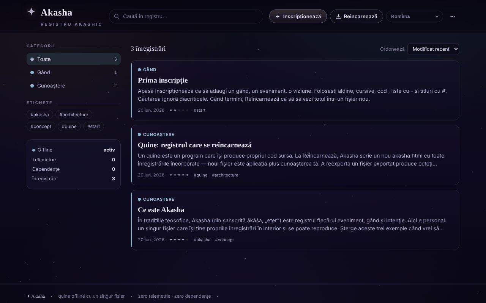

# Akasha

[English](README.md) · **Română** · [Français](README.fr.md) · [Italiano](README.it.md) · [Español](README.es.md) · [Português](README.pt.md) · [Deutsch](README.de.md) · [Magyar](README.hu.md)

**Versiune:** 1.1.8 · **Ultima actualizare:** 2026-10-23

Limbile interfeței: **Română, English, Français, Italiano, Español, Português (PT), Deutsch, Magyar**

Registru akashic offline: un quine HTML dintr-un singur fișier, care se reîncarnează cu toate înregistrările încorporate.

**Live:** https://chiuta.github.io/Akasha/

## Ce este

Akasha este un registru personal de înregistrări (gânduri, evenimente, cunoaștere, amintiri, viziuni, întrebări) într-un singur fișier `index.html`. Este un *quine*: când apăsați „Reîncarnează", aplicația scrie o copie nouă a ei însăși (`akasha.html`) cu toate înregistrările curente încorporate în fișier. Noul fișier este aplicația plus datele dumneavoastră.

## Funcții

- Înregistrări cu titlu, categorie (Gând, Eveniment, Cunoaștere, Amintire, Viziune, Întrebare), „rezonanță", etichete și conținut cu formatare simplă (`**aldin**`, `*cursiv*`, `` `cod` ``, liste, titluri).
- Căutare, filtrare după categorii și etichete, sortare (Modificat recent, Creat recent, Rezonanță, Alfabetic).
- Editare, duplicare și ștergere de înregistrări; meniu cu „Arhivă" și „Statistici" (înregistrări, cuvinte, etichete unice, zile acoperite, defalcare pe categorii).
- „Vezi propriul cod": afișează sursa completă pe care aplicația o scrie la reîncarnare (copiere sau descărcare).
- „Verifică integritatea": verifică proprietatea de fix-point (reexport cu octeți identici), prezența unică a blocului de date și reîncărcarea tuturor înregistrărilor.
- „Exportă JSON", „Exportă Markdown" (un singur fișier `akasha-records.md`, cu titluri în ordine alfabetică) și „Importă (JSON / .html)".
- Legături între înregistrări: `[[Titlu]]` în conținut devine legătură către înregistrarea cu acel titlu (cu majuscule/minuscule indiferente; legăturile fără țintă sunt estompate), iar în detaliu apare lista „Menționat în" (retrolegături).
- Tipărire: butonul „Tipărește" din detaliul unei înregistrări; stil de tipărire alb-negru (fără meniuri și fundal).
- Fundal cu stele, care poate fi pornit/oprit (în tema întunecată); tema luminoasă urmează preferința sistemului.
- Salvare automată de siguranță în browser, cu banner „Restaurează / Ignoră" pentru modificări mai noi decât fișierul; avertisment la închidere dacă există modificări nesalvate.
- Interfață în 58 de limbi (inclusiv română), cu suport pentru scriere de la dreapta la stânga (ar, he, fa, ur).

## Funcții noi (v1.1.0)

- **Citire cu voce tare** (sinteza vocală a browserului, `speechSynthesis`, prin `FFF.tts`): butonul din subsolul detaliului unei înregistrări rostește titlul, apoi textul; al doilea clic oprește; închiderea panoului oprește vocea. Limba vocii urmează limba interfeței. Dacă browserul nu are o voce pentru acea limbă (sau nu are sinteză), apare un mesaj și nu se rostește nimic. Calitatea și disponibilitatea vocilor depind de sistem.
- **Cod QR pentru o înregistrare**: din detaliu se generează un QR (prefix `akasha1:` + JSON cu titlul, categoria, rezonanța, etichetele și textul) de cel mult 1000 de octeți. Textul mai lung este **trunchiat, cu avertizare** („X din 6300 de caractere”); nu se simulează o capacitate pe care codul nu o are. Din meniu, „Citește QR dintr-o imagine” adaugă o **înregistrare nouă** (nu o suprascrie); conținutul este validat (categorie, rezonanță, lungimi), iar JSON stricat sau QR străin se resping.
- **Accesibilitate**: panou cu „Text mai mare” (zoom 1,2) și „Contrast ridicat” (inclusiv în tema luminoasă); preferințele se păstrează local și nu sunt încorporate în copiile reîncarnate.
- **Kit**: dialog „Transparență” și copie de siguranță `.fff.json` (modulele `core`, `label`, `bundle`, `qr`, `tts`). Fiindcă aplicația este un quine, dialogul avertizează că datele din fișierul reîncarnat nu intră în `localStorage` și deci nu sunt în copia `.fff.json`; sursa de adevăr rămâne „Reîncarnează”.
- **Limbi și traduceri**: Textele noi sunt scrise în română și engleză, cu variante maghiare și germane; restul limbilor folosesc engleza pentru funcțiile noi. Traducerile (hu, de) sunt automate și **neverificate de vorbitori nativi**; kitul are texte în 8 limbi, tot neverificate nativ.

## Manual de utilizare

1. Deschideți `index.html` în browser.
2. Apăsați „Inscripționează" (sau tasta `N`), completați titlul, categoria, rezonanța, etichetele și conținutul, apoi „Salvează".
3. Căutați cu câmpul de căutare (tasta `/`) sau filtrați din panoul „Categorii" / „Etichete"; schimbați ordinea din „Ordonează".
4. Deschideți o înregistrare pentru a o edita, duplica sau șterge.
5. **Pentru a păstra datele:** apăsați „Reîncarnează" (`Ctrl+S` / `Cmd+S`). Browserul descarcă `akasha.html`; deschideți acel fișier data viitoare, deoarece conține toate înregistrările.
6. Pentru copii de siguranță: meniul „Exportă JSON"; pentru a încărca date: „Importă (JSON / .html)".
7. Pentru limbă, folosiți selectorul de limbă din interfață (eticheta „Limbă").
8. Alte scurtături: `Esc` închide dialogul sau meniul; scurtăturile cu o singură tastă (`N`, `/`) sunt dezactivate în timp ce scrieți într-un câmp.

## Confidențialitate și rețea

- Kitul „fără frontiere” (`fff-kit`, modulele `core, label, bundle, qr, tts`) este lipit în `index.html`: nu face cereri de rețea. Dialogul „Transparență” (clic pe versiune) arată rețeaua declarată (0 cereri externe), cheile din `localStorage`, SHA-256 al fișierului și oferă copie de siguranță `.fff.json` (opțional criptată cu parolă, AES-GCM). Codurile QR se generează și se citesc local; citirea se face doar dintr-o imagine aleasă de utilizator, fără cameră.
- Citirea cu voce tare folosește motorul de vorbire al sistemului; unele sisteme îl pot trimite la un serviciu de rețea al furnizorului — aplicația nu controlează acest lucru.

- Aplicația nu conține apeluri de rețea (nu are `fetch`, CDN-uri sau resurse externe) și nu contactează niciun host terț.
- Datele sunt păstrate în blocul de date din interiorul fișierului HTML (sursa de adevăr). În plus, `localStorage` conține o copie de siguranță automată (cheia `akasha:autosave:v1`), ștearsă după reîncarnare.
- Nu există analitice; aplicația însăși afișează „Telemetrie: 0" și „Dependențe: 0".

## Rulare locală / offline

Descărcați `index.html` și deschideți-l direct din sistemul de fișiere (`file://`), fără server. Nu necesită internet.

## Licență

Licență MIT pentru codul și structura aplicației — vezi fișierul `LICENSE`. Eventualele biblioteci terțe incluse în fișier își păstrează licențele proprii.

## Audit

Audit: 2026-10-10 — verificat cu Playwright și axe-core; verificat în cod: fără `fetch`/CDN. Importul de înregistrări neîncrezătoare (JSON cu `</script>`, ``) a fost testat: textul este escapat, iar blocul de date se serializează cu `<` → `\u003c`. Corectat: lipseau marginile laterale (20 px) pe ecran îngust. Notă: numele „Akasha/registru akashic" este doar tematic — aplicația este un utilitar de notițe, fără pretenții esoterice.

## Istoric / Changelog

### 1.1.6 — 2026-10-22
- fff-kit 1.1.4: ținte tactile și text minim; ținte tactile/text corectate

### 1.1.5 — 2026-10-22
- fff-kit 1.1.2: PBKDF2 600 000 iterații, protecție anti-clickjacking

### 1.1.4 — 2026-10-22

service worker și manifest reale (pornește offline când e servită prin https; fișierul salvat funcționează în continuare din `file://`); indicator persistent „modificări nesalvate” cu buton „Reîncarnează” (înainte exista doar avertismentul la închiderea filei); ștergerea unei înregistrări cere confirmarea într-un dialog inline, nu prin `confirm()` blocant; eticheta de versiune „Transparență” are ținta tactilă potrivită. finisaje pentru mobil și accesibilitate: text de cel puțin 12 px și ținte tactile de cel puțin 24 px.

### 1.1.3 — 2026-10-22
- Titlul paginii (document.title) urmează acum limba interfeței (Akasha · slogan), nu mai rămâne în română.

- 1.1.1 — 2026-10-18: importul de registre nu mai schimbă preferința „stele” (`meta.stars` din fișier e ignorat); testul corespunzător.
- 1.1.0 — 2026-10-14: citire cu voce tare, cod QR pentru înregistrare (generare + citire din imagine), panou de accesibilitate (text mai mare, contrast ridicat; reparat contrastul în tema luminoasă), kit „fără frontiere” (Transparență + copie `.fff.json`). Teste: `tests/fff-r8.test.mjs`.

- 1.0.4 — 2026-10-12: versiunea și data ultimei actualizări sunt afișate în aplicație (subsol, cu etichetă tradusă).
- v1.0.3: **temă luminoasă** automată (`prefers-color-scheme: light`; implicit rămâne cea întunecată; fără comutator manual, deci fără texte noi de tradus); fundalul cu stele este ascuns în tema luminoasă. Culorile categoriilor din text sunt acum variabile CSS (`--cat`), închise în tema luminoasă pentru contrast. Corectat: caseta cu codul sursă („Vezi propriul cod”) nu putea fi derulată de la tastatură (acum are `tabindex="0"` și nume). Hash-ul CSP recalculat; „Verifică integritatea” reușită în ambele teme; axe-core = 0 violări la 1280 și 360 px în ambele teme, inclusiv în dialoguri.
- v1.0.2: previzualizarea din listă nu mai șterge cratimele din cuvinte (ex. „re-export”), ci doar marcajele de la începutul liniei; adăugate „Exportă Markdown”, legături `[[Titlu]]` cu „Menționat în”, butonul „Tipărește” și stil de tipărire (texte noi în 7 limbi; celelalte folosesc engleza). CSP: hash recalculat.
- Accesibilitate: titlul „Akasha” este h1, panourile laterale sunt h2, înregistrările nu mai folosesc `role="button"` pe `<article>` (acum `
`), canvasul de stele este ascuns pentru cititoarele de ecran; axe-core = 0 violări la 1280 și 360 px.
- Adăugată politică CSP (`<meta>`: scripturi doar pe bază de hash, `connect-src 'none'`); verificarea „Integritate quine” (fix-point) rămâne reușită.
- Previzualizarea unei înregistrări care conține text de tip `<script …` este afișată ca text simplu (escapată), nu interpretată; trunchierea ei este doar cosmetică.

## Autor

Alexio — Alexandru-Ionuț Chiuță. Contact: alexio@trom.tf

## Rezumat

Akasha este o „arhivă akashică” offline într-un singur fișier: un quine care, la „Reîncarnare” (Ctrl/Cmd+S), scrie o copie nouă a sa cu toate înregistrările încorporate. Are căutare, etichete, categorii, import/export JSON, verificare de integritate și interfață în 58 de limbi. Nu face cereri de rețea; o copie de siguranță cu salvare automată se păstrează în localStorage.
